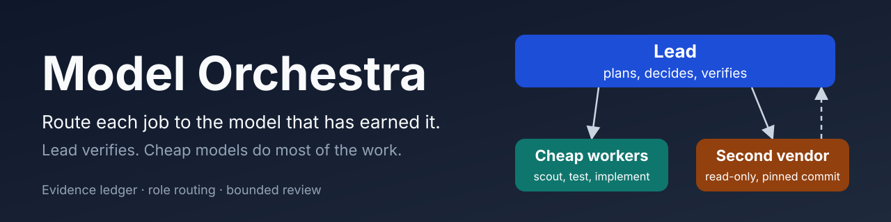
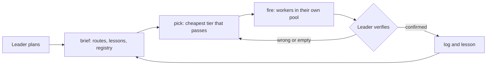

# Agent Orchestra

[](LICENSE)
[](https://github.com/osama-2000236/agent-orchestra/stargazers)



Keep your chosen model as the leader; send the reading, searching and first-pass review to the cheapest model that passes.

## The problem, measured

From 66 Claude Code sessions on one machine over the 14 days to 11 October 2026, at list-price equivalents ([details](docs/usage-root-causes.md)):

- The leader's own turns were **90%** of the $1,989 total, and each leader turn re-read **373k** cached context tokens on average.
- Subagents that inherited the leader's Opus model cost **$177** for 2,532 requests. Haiku 5.5 subagents cost **$6.6** for 2,599 requests.
- In a checked review, Haiku 5.5 at low effort called a removed permission check "CLEAN". At high effort it caught the problem. Effort matters as much as the model.
- Claude, ChatGPT/Codex and local models have separate usage limits. One exhausted limit stopped a reviewer, and another stopped the second vendor.

## What it does

- **The leader stays.** Your chosen model plans, makes every irreversible decision and gives the final verdict. Workers find, draft and check. The leader reads the cited line, runs the test or watches it fail before a claim counts.
- **A routing table.** Scouting, search and extraction start on Haiku at low effort. Design and wording review starts on Haiku at medium. Correctness, permission and money review starts on Haiku at high. Each escalates one step at a time: effort first, then a stronger tier, then a second vendor. Core implementation and verdicts stay with the leader.
- **Separate quota pools.** Claude subscription, ChatGPT/Codex and local models each have their own limit. When one is exhausted, the role moves to an equivalent tier in another pool instead of waiting.
- **A ledger that learns.** Each verified job is logged locally. A lesson becomes active after two supporting jobs and is retired when contradictions catch up.
- **Model registry.** `models update` lists what your runtimes offer and fills in prices from a public catalogue. `models rollback` restores the previous registry.
- **Measurement.** `usage` reads your Claude Code transcripts. `bench` runs three small checked tasks per model. `tune` sets two Claude Code settings, with a backup.

## Install

Claude Code, bash:

```bash
git clone https://github.com/osama-2000236/agent-orchestra
mkdir -p ~/.claude/skills/agent-orchestra
cp -r agent-orchestra/skill/. ~/.claude/skills/agent-orchestra/
```

Claude Code, Windows PowerShell:

```powershell
git clone https://github.com/osama-2000236/agent-orchestra
New-Item -ItemType Directory -Force "$env:USERPROFILE\.claude\skills\agent-orchestra" | Out-Null
Copy-Item -Recurse -Force agent-orchestra\skill\* "$env:USERPROFILE\.claude\skills\agent-orchestra"
```

Codex: copy the contents of `skill/` to `~/.codex/skills/agent-orchestra/`.

Invoke it with `/agent-orchestra` in Claude Code or `$agent-orchestra` in Codex.

**Upgrading from model-orchestra or subagent-orchestra:** copy your old `data/ledger.jsonl` and `data/lessons.jsonl` into the new folder's `data/`, then delete the old folder.

## Quick start

Run these from the repository root. After installing, the same script is at `~/.claude/skills/agent-orchestra/scripts/orchestra.mjs`.

```bash
node skill/scripts/orchestra.mjs tune                       # show the two Claude Code settings it would set
node skill/scripts/orchestra.mjs tune --apply               # set them, keeping a backup
node skill/scripts/orchestra.mjs models update              # refresh the registry (no model calls)
node skill/scripts/orchestra.mjs models list                # models, pools, tiers and prices
node skill/scripts/orchestra.mjs bench --new                # three small checked tasks per new model (model calls)
node skill/scripts/orchestra.mjs brief                      # verified routes and active lessons: start here
node skill/scripts/orchestra.mjs pick review-code --preset balanced
node skill/scripts/orchestra.mjs usage --last 3             # where the last three sessions' usage went
node skill/scripts/orchestra.mjs log --file outcome.json    # one row per worker task you verified
node skill/scripts/orchestra.mjs lesson --file lesson.json  # the one rule that most changed total work
node skill/scripts/orchestra.mjs models rollback            # restore the previous registry
```

`pick` estimates cost and ranks the candidates offline. It never calls a model. Every option is listed in [docs/configuration.md](docs/configuration.md).

## How it works

1. **Leader**: plans the job and keeps every irreversible step.
2. **Brief**: `brief` prints the verified route per role, the active lessons and the registry.
3. **Route**: `pick` chooses the cheapest tier that passes for the role.
4. **Fire**: workers run in their own quota pool, each with a model and effort named.
5. **Verify and learn**: the leader checks each claim, then logs outcomes and at most one lesson.



## Benchmarks

`bench` gives each model three tiny tasks with one right answer: find the buggy line in a six-line function, extract a total from an invoice sentence, and spot a removed permission check in a diff. It records pass or fail, time and cost in `data/bench.jsonl`. The results are small smoke tasks, not a leaderboard, and passing them does not prove a model can review a release. See [docs/benchmarks.md](docs/benchmarks.md).

## Configuration

Data files, environment variables, `pick` and `tune` options, and pricing rules are in [docs/configuration.md](docs/configuration.md). The modules and the self-improvement loop are in [docs/architecture.md](docs/architecture.md).

## Compared with Claude Managed Agents

Claude Managed Agents runs agents in Anthropic's cloud, on an API key, with a session budget and a runtime fee. Agent Orchestra runs on your machine inside Claude Code, Codex or another host, and it spends your subscription quota instead. The ideas it borrows (per-worker model and effort, an advisor, compaction, budgets) are reimplemented locally. See [skill/references/managed-agents.md](skill/references/managed-agents.md).

## Privacy

- The ledger, lessons, bench rows and model registry stay on your machine, in the skill's `data/` folder.
- Claude Code transcripts are read locally from `~/.claude/projects/`. Nothing is uploaded.
- The only network calls are these:
  - `models update` fetches the public OpenRouter model catalogue. `--offline` skips it.
  - `models update` lists models from a provider's endpoint when its API key variable is set (`ANTHROPIC_API_KEY`, `OPENAI_API_KEY` or `XAI_API_KEY`).
  - `bench` makes model calls. Nothing else does.

## Contributing, support and sponsorship

- Contributing: see [CONTRIBUTING.md](CONTRIBUTING.md). Run `node --test` before you open a pull request.
- Support: bug reports, anonymized evaluations and small tested improvements help most. See [SUPPORT.md](SUPPORT.md).
- Sponsor: sponsorship opens once GitHub Sponsors is approved. The funding file names the owner; it is not a live payment link yet.

## License

[MIT](LICENSE)
