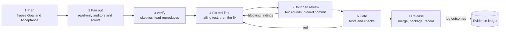
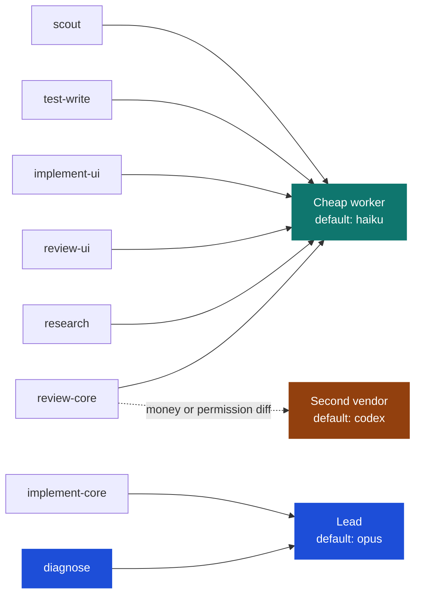
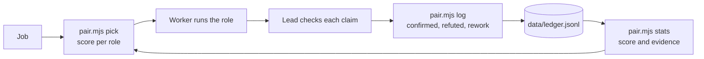

# Model Orchestra

[](LICENSE)
[](https://github.com/osama-2000236/ai-model-orchestra/stargazers)


Model Orchestra is a Claude Code skill. It splits a job into roles, gives each role to the model that has the best
verified record for it, and checks every result before it counts. Cheap models do the scouting, the test writing and
most of the implementation. One lead model plans, decides and verifies. An independent second vendor reviews the
changes that move money, stock, permissions or security.

The routing is not based on reputation. Every outcome is logged as confirmed, refuted or reworked, and the next
pick uses those logs.

## Why

Much of a software job is reading code, searching it and writing tests. Those steps do not need the most capable
model. Sending everything to the most capable model is expensive, and someone still has to check what comes back.

A cheap model is wrong sometimes. The lead checks every claim before it becomes a fact. The ledger records how
often each model's claims held up, and that record decides who gets the next job.

Two patterns carry most of the quality gain:

- **Skeptics.** A finding is not kept just because a model reported it. A second model tries to refute it from the code.
  In the example ledger, several claims that looked blocking did not hold. One was refuted because a guard already refused
  the case. Another was downgraded because the amounts netted to zero. The lead recorded both.
- **A second vendor.** A reviewer from another model family misses different things. In the example project, the
  second vendor caught a cost leak in a storekeeper's preview that the cheap UI reviewer had missed. In round two of the
  same change, it caught a regression, introduced by a round-one fix, in how a fully offset foreign-currency debt was handled.

## Quick start

1. Install the skill. Copy the `skill` folder to your Claude Code skills directory, under the name `model-orchestra`.

   macOS and Linux:
   ```bash
   git clone https://github.com/osama-2000236/ai-model-orchestra
   cp -r ai-model-orchestra/skill ~/.claude/skills/model-orchestra
   ```

   Windows (PowerShell):
   ```powershell
   git clone https://github.com/osama-2000236/ai-model-orchestra
   Copy-Item -Recurse ai-model-orchestra\skill "$env:USERPROFILE\.claude\skills\model-orchestra"
   ```

2. Look at the evidence. This reads the anonymized example ledger, because your own ledger does not exist yet:
   ```bash
   node ~/.claude/skills/model-orchestra/scripts/pair.mjs stats
   ```
3. Ask Claude Code for a job: "orchestrate models for this audit", or "use a second vendor to review this diff".
   The skill loads when you name it or use one of its trigger phrases.
4. Log every verified outcome. Your own ledger is created in the skill's `data` folder:
   ```bash
   node ~/.claude/skills/model-orchestra/scripts/pair.mjs log '{"project":"my-repo","task":"review of the pay run","model":"haiku","role":"review-core","confirmed":3,"refuted":1,"rework":0,"minutes":6,"note":"one refuted claim was a design choice"}'
   ```

The second vendor is optional. See the FAQ for a setup with Claude models only.

## Roles

| Role | Job | Output |
| --- | --- | --- |
| **lead** | Plans, decides irreversible calls, verifies every claim, gives the verdict | Plan, decisions, report |
| **scout** | Reads code and reports where things are | Findings with `file:line` evidence |
| **test-write** | Writes a reproduction and a test that fails today | A red test |
| **implement-core** | Makes a root-cause fix to logic that moves money, stock, permissions or data | A diff with the tests it touches |
| **implement-ui** | Makes a bounded change to screens, styles and labels | A diff with the UI tests |
| **review-core** | Reviews logic on a pinned commit | Findings with `blocking?` |
| **review-ui** | Reviews screens and styles on a pinned commit | Findings with `blocking?` |
| **research** | Finds how established products behave, with sources | Decisions with URLs |
| **diagnose** | Finds the root cause of a failure that is not obvious | Cause, proof, fix proposal |

The full role contracts, with the things each role must not do, are in [docs/roles.md](docs/roles.md).

## Default model per role, with evidence

The defaults come from the example ledger: anonymized data from a real two-day project. The score is the smoothed
share of checked claims that held, minus a small penalty for rework. "Checked" means the lead verified it.

| Role | Default model | Score | Checked claims | Evidence |
| --- | --- | --- | --- | --- |
| scout | haiku | 0.865 | 35 (31 confirmed, 4 refuted) | proven |
| test-write | haiku | 0.900 | 8 | proven |
| implement-core | haiku, with lead review | 0.879 | 26 (4 of 10 tasks reworked) | proven |
| implement-ui | haiku | 0.767 | 3 (1 task reworked) | proven |
| review-core | haiku, plus second vendor on money and permission diffs | 0.857 | 33 (4 refuted) | proven |
| review-core | codex (second vendor) | 0.875 | 6 | proven, 3 tasks |
| review-ui | haiku | 0.895 | 17 | proven |
| research | haiku | 0.941 | 15 | proven, 1 task |
| diagnose | lead (opus) | 0.667 | 1 | trial |
| implement-core, money and permission | lead (opus) | 0.667 | 1 | trial |

Read this table with three cautions:

- **The score alone would give implement-core to Haiku.** The hard rule keeps money, stock, permission and data work with
  the lead, and the lead verifies every core fix. Four of ten Haiku core-fix tasks needed a rework round, and each was
  caught in review.
- **The lead's own row is thin.** It has two tasks. Its default comes from the rule, not from the evidence.
- **The second vendor's score is not higher.** On `review-core` it is 0.875 against Haiku's 0.857, which is inside the
  near-tie band. `pick` therefore returns the cheaper model. The second vendor is still assigned to money and permission
  diffs, because it finds different defects.

## The loop

Each job goes through this loop. Any step can send the job back.



The playbooks for each stage are in [docs/playbooks.md](docs/playbooks.md). Three examples of the fan-out, skeptic and
research steps are in [examples/](examples/).

## Routing: role to model



Solid arrows are the default route. The dashed arrow is the second vendor, used for money and permission diffs (playbook 3).

## Evidence feedback loop



Only checked outcomes go into the ledger. A model's report of its own success is not evidence.
The scoring details and thresholds are in [docs/cost-model.md](docs/cost-model.md).

## Cost and quality results

These numbers come from the anonymized example ledger: 44 verified worker tasks over two days, on one project.

| Measure | Result |
| --- | --- |
| Tasks sent to the cheap model | 39 of 44 (89%) |
| Tasks sent to the second vendor | 3 |
| Tasks kept by the lead | 2 |
| Lead-checked claims that held | 137 of 149 (92%) |
| Claims refuted by the lead | 12 |
| Cost of worker tasks, relative to running all of them on the lead | about 45% |

The 45% uses relative weights of 1 for Haiku, 3 for the second vendor and 5 for the lead, applied to the minutes each
task took. It does not include the lead's verification time, which the ledger does not record. So the real saving is
smaller than 55%. Replace the weights with your own prices.

Quality results, from the same ledger:

- Four of ten Haiku core-fix tasks needed a rework round after review. Each was caught in review.
- In one audit run, the lead refuted two of eleven checked findings. One pair of entries netted to zero, and one claimed
  contradiction between two records did not hold.
- The second vendor caught a cost leak that the cheap reviewer missed, and a regression that a round-one fix had introduced.

This is one developer, one project and two days. It is not a benchmark.

## FAQ

**Do I need a second vendor?**
No. Use two Claude models of different tiers for the review round, for example Haiku and Sonnet. Expect them to share more
blind spots than models from two families do.

**Does the lead still need to verify everything if the workers are good?**
Yes. Workers are wrong sometimes, and a false "defect" costs time to refute. The example ledger has 12 refuted claims out of 149 checked.

**Will this make my AI bill smaller?**
The mix of cheap workers and a lead usually costs less than running everything on the lead. Extra review rounds add cost.
Measure your own mix with `stats` before you quote a saving.

**Why did `pick` choose the cheaper model when another scored higher?**
Scores within 0.08 of each other count as a tie, and the cheaper model wins. The hard rules still apply. See
[docs/cost-model.md](docs/cost-model.md).

**Is my ledger private?**
Yes, unless you share it. It holds task descriptions and notes from your project. The repository's `.gitignore` excludes
`skill/data/ledger.jsonl`. Only the anonymized example is committed.

**Can I use it outside code?**
The research playbook works for documents and policy questions. The rest is built for code, with tests as the check.

**How do I add a model?**
Add it to `COST` in `scripts/pair.mjs` with its relative cost, then log its outcomes. `pick` ranks it with the others once it has rows.

**Where was it tested?**
`pair.mjs` ran on Windows 11 with Node 24, and it uses only Node built-ins. The workflow examples in `examples/` were
written for a workflow runner and have not been run from this repository. Check them in your runner before you rely on them.

## Repository layout

```
skill/             the Claude Code skill (copy this folder)
  SKILL.md         the instructions the model follows
  scripts/pair.mjs the ledger, picker and stats
  data/            ledger.example.jsonl (anonymized seed data)
examples/          three workflow scripts: audit fan-out, repro batch, market research
docs/              playbooks, roles, cost model, and two SVG figures
.github/           funding, issue templates
```

## Sponsor

If the skill saves you money or review time, you can support its development on
[GitHub Sponsors](https://github.com/sponsors/osama-2000236).

## Contributing and license

Read [CONTRIBUTING.md](CONTRIBUTING.md) before you open a pull request. This project follows the
[Code of Conduct](CODE_OF_CONDUCT.md). Changes are listed in [CHANGELOG.md](CHANGELOG.md).
Released under the [MIT License](LICENSE).
